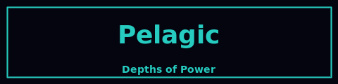

# BroWarz — Corporations

Each playable corporation has a unique identity: motto, background, distinctive color, and gameplay modifiers. Units and buildings use the corporation color for quick identification.

## AeroDyne Industries

- **Motto:** "Dominion of the Skies"
- **Background:** An aerospace megacorp dominating orbital and aerial warfare. Founded from a satellite network conglomerate, AeroDyne controls the high ground.
- **Color:** Sky Blue `#3FBFFF`
- **Strengths:** Air superiority, orbital laser cooldown reduction, cheaper aerial drones.
- **Weaknesses:** Lighter ground armor, fewer heavy tanks.
- **Preferred units:** Scout/fighter/bomber drones, AWACS, orbital laser uplink.
- **Signature:** Cheaper aerial drones; orbital laser cooldown −15%.

## FerroCore Heavy

- **Motto:** "Iron Will, Iron Fist"
- **Background:** A heavy-industry giant specializing in armor and siege. FerroCore builds the thickest armor and biggest guns.
- **Color:** Amber `#FF8C26`
- **Strengths:** Heavy tanks, sappers, fortifications.
- **Weaknesses:** Slower air force, limited stealth.
- **Preferred units:** Main battle tanks, heavy tanks, artillery, sapperbots, turrets.
- **Signature:** Heavier tanks; sappers destroy fortifications faster.

## Pelagic Systems

- **Motto:** "Depths of Power"
- **Background:** A naval conglomerate ruling the seas and depths. Pelagic controls shipping lanes and submarine warfare.
- **Color:** Teal `#26CCC0`
- **Strengths:** Naval superiority, submarine stealth, cheaper sea drones.
- **Weaknesses:** Weaker land armor, limited air force.
- **Preferred units:** Patrol boats, corvettes, submarines, frogmen, shipyards.
- **Signature:** Submarines start cloaked; cheaper sea drones.

## Vanguard Robotics

- **Motto:** "Unseen, Unstoppable"
- **Background:** A stealth and infantry specialist of covert operations. Vanguard excels at ambush and rapid infantry deployment.
- **Color:** Violet `#BF59F2`
- **Strengths:** Stealth, infantry, mechanized units.
- **Weaknesses:** Lighter vehicles, limited naval presence.
- **Preferred units:** Stealthbots, sniperbots, rocketbots, mechanized infantry, light mechs.
- **Signature:** Stealth units cloak longer; mechanized infantry cheaper.

## Unit Colors
Unit and building sprites use the corporation color of their owner so factions are identifiable at a glance on the battlefield.
