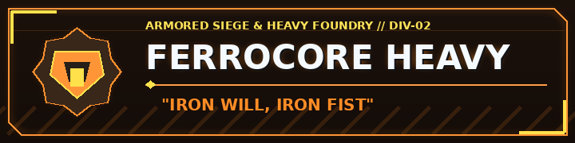
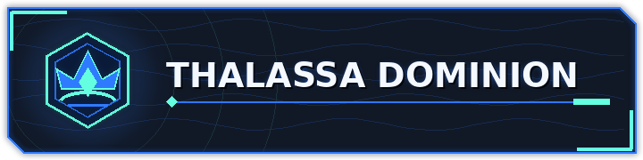

# BroWarz — Corporations

Each playable corporation is one of four weapons divisions of a single planetary megacorp ("Terran Herzog Heavy Industries") that rules the planet. The RTS match is how the four divisions settle their dividing of planetary resources — borders are drawn by match results.

Each playable corporation has a unique identity: motto, background, distinctive color, and gameplay modifiers. Units and buildings use the corporation color for quick identification. When two players run the *same* corporation against each other (e.g. 2v2), the colors read as a chess game: the corporation keeps its base color and the opposing player uses black (`#0a0a0b`) or white (`#f7f7f8`), letting them be told apart.

## AeroDyne Industries

- **Motto:** "Dominion of the Skies"
- **Background:** An aerospace megacorp dominating orbital and aerial warfare. Founded from a satellite network conglomerate, AeroDyne controls the high ground.
- **Color:** Sky Blue `#3FBFFF`
- **Strengths:** Air superiority, orbital laser cooldown reduction, cheaper aerial drones.
- **Weaknesses:** Lighter ground armor, fewer heavy tanks.
- **Preferred units:** Scout/fighter/bomber drones, AWACS, orbital laser uplink.
- **Signature:** Cheaper aerial drones; orbital laser cooldown −15%.

## FerroCore Heavy

- **Motto:** "Iron Will, Iron Fist"
- **Background:** A heavy-industry giant specializing in armor and siege. FerroCore builds the thickest armor and biggest guns.
- **Color:** Amber `#FF8C26`
- **Strengths:** Heavy tanks, sappers, fortifications.
- **Weaknesses:** Slower air force, limited stealth.
- **Preferred units:** Main battle tanks, heavy tanks, artillery, sapperbots, turrets.
- **Signature:** Heavier tanks; sappers destroy fortifications faster.

## Pelagic Systems

- **Motto:** "Depths of Power"
- **Background:** A naval conglomerate ruling the seas and depths. Pelagic controls shipping lanes and submarine warfare.
- **Color:** Teal `#26CCC0`
- **Strengths:** Naval superiority, submarine stealth, cheaper sea drones.
- **Weaknesses:** Weaker land armor, limited air force.
- **Preferred units:** Patrol boats, corvettes, submarines, frogbots, shipyards.
- **Signature:** Submarines start cloaked; cheaper sea drones.

## Vanguard Robotics

- **Motto:** "Unseen, Unstoppable"
- **Background:** A stealth and infantry specialist of covert operations. Vanguard excels at ambush and rapid infantry deployment.
- **Color:** Violet `#BF59F2`
- **Strengths:** Stealth, infantry, mechanized units.
- **Weaknesses:** Lighter vehicles, limited naval presence.
- **Preferred units:** Stealthbots, sniperbots, rocketbots, mechanized infantry, light mechs.
- **Signature:** Stealth units cloak longer; mechanized infantry cheaper.

## AI-Only Factions (IDs 4–7)

The factions below are **not human-selectable corporations**. They are AI-only sides: skirmish enemies, the co-op AI and either spectator side. Human seats — skirmish, co-op and map-editor test play — stay with the four corporations above. Their full rosters, banners, themes and strategy guide are in [`npc.md`](npc.md).

## AI-only: Vesper Ascendancy (ID 4, `vesper`)

- **Status:** AI-only; never a human seat.
- **Motto:** "Dominion begins above."
- **Background:** An alien ascendancy that arrived in silent saucers and claims the planet's skies as its own airspace.
- **Color:** Magenta `#FF4FD8`, accent lime `#C7FF4F`.
- **Strengths:** Air damage ×1.20, air speed ×1.30; fast saucer skirmishers.
- **Weaknesses:** Vehicle/ground HP ×0.80.
- **Unique units:** `ufo_wisp`, `ufo_talon`, `ufo_nova`.
- **Full guide:** [`npc.md`](npc.md).

## AI-only: Thalassa Dominion (ID 5, `thalassa`)

- **Status:** AI-only; never a human seat.
- **Motto:** "The sea remembers its masters."
- **Background:** An Atlantean dominion rising from the abyss to reclaim the shipping lanes and continental shelf.
- **Color:** Blue `#2F7BFF`, accent cyan `#64FFE0`.
- **Strengths:** Naval HP ×1.25, naval damage ×1.15, sea unit cost ×0.90.
- **Weaknesses:** Land/air damage ×0.85.
- **Unique units:** `abyssal_trireme`, `leviathan_carrier`, `nereid_raider`.
- **Full guide:** [`npc.md`](npc.md).

## AI-only: Gravebound Legion (ID 6, `gravebound`)

- **Status:** AI-only; never a human seat.
- **Motto:** "The fallen still march."
- **Background:** A legion of reanimated dead that never tires, pressing attrition wars with cheap resilient infantry.
- **Color:** Olive `#8FBF3F`, accent bone `#D8C9A3`.
- **Strengths:** Infantry HP ×1.20, infantry cost ×0.85; sight ×0.85.
- **Weaknesses:** Vehicle/air HP ×0.80.
- **Unique units:** `bone_legionary`, `ghoul_stalker`, `lichen_colossus`.
- **Full guide:** [`npc.md`](npc.md).

## AI-only: Lumen Cabal (ID 7, `lumen`)

- **Status:** AI-only; never a human seat.
- **Motto:** "We saw you coming."
- **Background:** A hidden cabal fighting with foreknowledge, veiled agents and perfectly timed ambushes.
- **Color:** Gold `#F2D65B`, accent violet `#9B7BFF`.
- **Strengths:** Sight ×1.25, stealth duration ×1.30.
- **Weaknesses:** All unit cost ×1.10, all HP ×0.90.
- **Unique units:** `lumen_operative`, `lumen_oracle`, `lumen_enforcer`.
- **Full guide:** [`npc.md`](npc.md).

## Unit Colors
Unit and building sprites use the corporation color of their owner so factions are identifiable at a glance on the battlefield. A same-corporation mirror match uses the chess black/white variants from `Faction.color_of(id, variant)` so the two sides remain readable.

## Diplomatic Doctrine

The divisions negotiate as rivals inside one megacorp: an alliance is a temporary resource-budget accord, not a merger. Every corporation follows the same in-match rules in [`diplomacy.md`](diplomacy.md); none receives a diplomacy-specific gameplay bonus. Their narrative postures differ:

| Corporation | Negotiating style | Typical alliance goal |
|---|---|---|
| **AeroDyne Industries** | Precise, transactional airspace pacts | Protect drone corridors and orbital uplink windows. |
| **FerroCore Heavy** | Blunt border agreements | Secure flank against armored pushes while siege works finish. |
| **Pelagic Systems** | Shipping-lane and seabed accords | Keep sea lanes open and submarine deterrents pointed elsewhere. |
| **Vanguard Robotics** | Quiet non-aggression understandings | Cover covert infantry deployments and reconnaissance. |

Any two divisions can sign a short-lived side agreement in a 3+ team match. Allied teams share vision and refuse friendly fire, but keep their own colors, emblems, resources, factories, research and unit control. In co-op the host picks the shared human corporation (IDs 0–3), the AI faction (IDs 0–7) and AI difficulty; in spectator the **Spectator AI Side A** and **AI Opponent / Side B** selectors pick the two AI sides (both IDs 0–7). Faction choice changes each squad's color/signature identity, never the alliance rules.

### AI-only doctrinal flavor

These AI-only postures are flavor for AI-controlled sides, not a separate diplomacy ruleset and not a human option. Each obeys the same shared vision/friendly-fire rules in [`diplomacy.md`](diplomacy.md) and receives no diplomacy-specific bonus.

| AI-only faction | Negotiating style | Typical objective |
|---|---|---|
| **Vesper Ascendancy** | Condescending airspace ultimatums | Clear the sky so saucers can strike at will. |
| **Thalassa Dominion** | Tidal non-aggression pacts | Keep sea lanes open for carrier and battleship fleets. |
| **Gravebound Legion** | Silent, inevitable demands | Pin enemies in place until attrition breaks them. |
| **Lumen Cabal** | Veiled favors and concealed terms | Hide reconnaissance and infiltration until the decisive strike. |

Full AI-only identities and combat modifiers are in [`npc.md`](npc.md).
