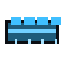
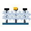

# BroWarz — Factories & Production Structures

Production in BroWarz is organized into tiered industrial facilities across land, naval, and aerial domains. Capturing or destroying all of an enemy corporation's production facilities eliminates their ability to sustain warfare and wins the match. Each player starts with **only an HQ** and a small unit escort (including a scout drone); every other building must be built or captured. The four AI-only NPC factions use these same production buildings and the shared roster; they have no exclusive structures and cannot construct anything beyond this shared set. Thumbnails show the AeroDyne (faction 0) render of each building.

---

## 1. Command & Logistics

### Headquarters (`hq`)

- **Footprint:** 3 × 3 tiles
- **HP:** 1,200
- **Cost:** 400 Iron, 100 Food (Build Time: 12.0s)
- **Role:** Primary corporate command center and base population anchor. The only starting building.
- **Produces:** Basic `engineerbot` construction droids and coordinates orbital/strategic uplinks.

---

## 2. Ground & Mech Production

### Mech Factory 1 (`mech_factory_1`)

- **Footprint:** 2 × 2 tiles
- **HP:** 650
- **Cost:** 60 Oil, 170 Iron, 40 Food (Build Time: 6.0s)
- **Built By:** Basic `engineerbot` or `hq`
- **Role:** Assembly plant for smaller infantry robots and light scout walkers.
- **Produces:**
  - `riflebot` (Line Infantry Robot)
  - `heavybot` (Mountain-Capable Heavy Infantry Robot)
  - `sapperbot` (Demolition & Fortification Bot)
  - `stealthbot` (Cloaked Recon/Ambush Bot)
  - `sniperbot` (Long-Range Precision Bot)
  - `rocketbot` (Anti-Armor Infantry Bot)
  - `medicbot` (Field Repair Support Bot)
  - `engineerbot` (Standard Construction Bot)
  - `light_mech` (Fast Bipedal Scout Mech)
  - `light_tank` (Fast Recon Tank)

### Mech Factory 2 (`mech_factory_2`)

- **Footprint:** 3 × 2 tiles
- **HP:** 850
- **Cost:** 120 Oil, 260 Iron, 50 Geothermal, 50 Food (Build Time: 8.5s)
- **Built By:** `engineerbot` (Requires T2 Tech)
- **Role:** Heavy assembly line for medium-sized armored combat vehicles and **Advanced Construction Bots** (`adv_engineerbot`).
- **Produces:**
  - `adv_engineerbot` (**Advanced Construction Bot** — required to construct **Mech Factory 3**, **Advanced Shipyard**, and **Aeries Level 2**)
  - `apc` (6×6 Armored Personnel Carrier / IFV)
  - `mbt` (Main Battle Tank)
  - `artillery` (Self-Propelled Siege Howitzer)
  - `aa_vehicle` (Mobile Quad-Flak Air Defense Vehicle)

### Mech Factory 3 (`mech_factory_3`)

- **Footprint:** 3 × 3 tiles
- **HP:** 1,150
- **Cost:** 220 Oil, 420 Iron, 150 Geothermal, 70 Food (Build Time: 12.0s)
- **Built By:** **Only buildable by Advanced Construction Bots (`adv_engineerbot`)** (Requires T3 Tech)
- **Role:** Apex heavy foundry capable of fabricating super-heavy armor and colossal killer mechs.
- **Produces:**
  - `heavy_tank` (Twin-Barrel Siege Mammoth Tank)
  - `heavy_mech` (Heavy Killer Mech)
  - `siege_mech` (Long-Range Thermal Bombardment Mech)

---

## 3. Maritime & Subsurface Production

### Docks (`docks`)

- **Footprint:** 2 × 2 tiles (Coastal / Water edge)
- **HP:** 550
- **Cost:** 50 Oil, 160 Iron, 25 Food (Build Time: 5.5s)
- **Built By:** `engineerbot`
- **Role:** Littoral naval berth for patrol craft, amphibious transports, and stealth amphibious bots.
- **Produces:**
  - `patrol_boat` (Patrol Sea Drone)
  - `landing_craft` (Amphibious Transport)
  - `hovercraft` (Amphibious Air-Cushion Craft)
  - `frogbot` (Amphibious Stealth Demolition Frogbot)

### Shipyard (`shipyard`)

- **Footprint:** 3 × 2 tiles (Water)
- **HP:** 750
- **Cost:** 90 Oil, 220 Iron, 30 Geothermal, 30 Food (Build Time: 7.5s)
- **Built By:** `engineerbot` (Requires T2 Tech)
- **Role:** Fleet drydock for blue-water escort warships and attack submarines.
- **Produces:**
  - `corvette` (Guided-Missile Corvette)
  - `attack_sub` (Torpedo Attack Submarine)
  - `cruiser` (Guided-Missile Cruiser)

### Advanced Shipyard (`advanced_shipyard`)

- **Footprint:** 3 × 3 tiles (Deep Water)
- **HP:** 1,050
- **Cost:** 180 Oil, 360 Iron, 110 Geothermal, 50 Food (Build Time: 11.5s)
- **Built By:** `adv_engineerbot` (Requires T3 Tech)
- **Role:** Capital naval yard for dreadnought battleships, fleet carriers, and strategic nuclear submarines.
- **Produces:**
  - `battleship` (Heavy Dreadnought Battleship)
  - `aircraft_carrier` (Fleet Aircraft Carrier)
  - `ballistic_sub` (Ballistic-Missile Strategic Submarine)

---

## 4. Aerial & Orbital Production (Aeries)

### Aeries Level 1 (`aeries_1`)

- **Footprint:** 2 × 2 tiles
- **HP:** 650
- **Cost:** 90 Oil, 190 Iron, 40 Geothermal, 30 Food (Build Time: 7.0s)
- **Built By:** `engineerbot`
- **Role:** Tactical drone launchpad and flight deck for reconnaissance and air-superiority UAVs.
- **Produces:**
  - `scout_drone` (High-Speed Recon Aerial Drone)
  - `fighter_drone` (Air-Superiority Delta Fighter Drone)

### Aeries Level 2 (`aeries_2`)

- **Footprint:** 3 × 2 tiles
- **HP:** 920
- **Cost:** 170 Oil, 310 Iron, 110 Geothermal, 45 Food (Build Time: 10.0s)
- **Built By:** `adv_engineerbot` (Requires T3 Tech)
- **Role:** Heavy stratospheric flight wing for strike bombers and airborne radar command craft.
- **Produces:**
  - `bomber_drone` (Heavy Flying-Wing Strike Bomber)
  - `awacs` (AWACS Airborne Radar & EMP Drone)

---

## 5. Economy, Research & Defense

These structures are built or captured after the match opens with an HQ alone. Sapperbots construct the three fortifications (`wall`, `barbed_wire`, `missile_tower`); `engineerbot` builds the rest (and `adv_engineerbot` can build any of them).

### Resource Extractor (`extractor`)

- **Footprint:** 2 × 2 tiles
- **HP:** 450
- **Cost:** 30 Oil, 120 Iron, 20 Food (Build Time: 5.0s)
- **Role:** Harvests a finite oil, iron, geothermal, or food deposit.

### Hydroponic Farm (`farm`)

- **Footprint:** 2 × 2 tiles
- **HP:** 400
- **Cost:** 20 Oil, 100 Iron, 30 Food (Build Time: 4.5s)
- **Role:** Raises the food-based population cap.

### Geothermal Plant (`power_plant`)

- **Footprint:** 2 × 2 tiles
- **HP:** 550
- **Cost:** 50 Oil, 160 Iron, 20 Geothermal, 20 Food (Build Time: 6.0s)
- **Role:** Feeds the power grid; brownouts slow production and shrink radar sweeps.

### Research Lab (`research_lab`)

- **Footprint:** 2 × 2 tiles
- **HP:** 600
- **Cost:** 80 Oil, 180 Iron, 60 Geothermal, 30 Food (Build Time: 7.0s)
- **Role:** Unlocks tech tiers and upgrades.

### Radar Array (`radar`)

- **Footprint:** 2 × 2 tiles
- **HP:** 480
- **Cost:** 60 Oil, 140 Iron, 50 Geothermal, 20 Food (Build Time: 5.5s)
- **Role:** Powered 480 px sweep that reveals terrain and cloaked contacts; the sweep scales with power efficiency.

### Defense Turret (`turret`)

- **Footprint:** 1 × 1 tile
- **HP:** 520
- **Cost:** 40 Oil, 150 Iron, 20 Geothermal, 15 Food (Build Time: 4.5s)
- **Role:** Static point defense with a short sight perimeter.

### Nuclear Missile Silo (`silo`)

- **Footprint:** 3 × 3 tiles
- **HP:** 900
- **Cost:** 250 Oil, 400 Iron, 300 Geothermal, 80 Food (Build Time: 14.0s)
- **Role:** Stores and launches strategic nuclear missiles.

### Orbital Laser Uplink (`orbital_uplink`)

- **Footprint:** 2 × 2 tiles
- **HP:** 850
- **Cost:** 200 Oil, 350 Iron, 280 Geothermal, 60 Food (Build Time: 12.0s)
- **Role:** Targets the late-game orbital laser strike.

### Missile Tower (`missile_tower`)

- **Footprint:** 2 × 2 tiles
- **HP:** 600
- **Cost:** 30 Oil, 120 Iron, 60 Geothermal (Build Time: 6.0s)
- **Built By:** `sapperbot`
- **Role:** Anti-air battery with a powered 320 px radar sweep; does not block movement.

### Barrier Wall (`wall`)

- **Footprint:** 1 × 1 tile
- **HP:** 900
- **Cost:** 900 Iron (Build Time: 2.0s)
- **Built By:** `sapperbot`
- **Role:** Blocks all ground movement.

### Barbed Wire (`barbed_wire`)

- **Footprint:** 1 × 1 tile
- **HP:** 150
- **Cost:** 150 Iron (Build Time: 1.0s)
- **Built By:** `sapperbot`
- **Role:** Impedes infantry only; vehicles can pass.

### Legacy aliases

- `barracks` — Robot Barracks (Mech Factory 1): 
- `factory` — Armor & Mech Factory (Mech Factory 2): 
- `airfield` — Drone Airfield (Aeries Level 1): 

---

## 6. Summary Table

| Building ID | Display Name | Tier | Builder Required | Primary Output Domain |
|---|---|---|---|---|
| `hq` | Corporate HQ | T1 | Starting / `engineerbot` | Command & Basic Engineers |
| `docks` | Naval Docks | T1 | `engineerbot` | Littoral Craft, Hovercraft, Frogbots |
| `mech_factory_1` | Mech Factory 1 | T1 | `engineerbot` | Small Infantry Bots & Light Mechs |
| `mech_factory_2` | Mech Factory 2 | T2 | `engineerbot` | Medium Armor & Advanced Construction Bots |
| `mech_factory_3` | Mech Factory 3 | T3 | **`adv_engineerbot` only** | Heavy Tanks, Heavy Killer Mechs, Siege Mechs |
| `shipyard` | Naval Shipyard | T2 | `engineerbot` | Corvettes, Attack Subs, Cruisers |
| `advanced_shipyard` | Advanced Shipyard | T3 | `adv_engineerbot` | Battleships, Aircraft Carriers, Ballistic Subs |
| `aeries_1` | Aeries Level 1 | T1/T2 | `engineerbot` | Scout Drones & Fighter Drones |
| `aeries_2` | Aeries Level 2 | T3 | `adv_engineerbot` | Bomber Drones & AWACS Radar Drones |
| `extractor` | Resource Extractor | — | `engineerbot` | Resource Harvesting |
| `farm` | Hydroponic Farm | — | `engineerbot` | Food / Population Cap |
| `power_plant` | Geothermal Plant | — | `engineerbot` | Power Grid |
| `research_lab` | Research Lab | — | `engineerbot` | Tech & Upgrades |
| `radar` | Radar Array | — | `engineerbot` | 480 px Powered Radar Sweep |
| `turret` | Defense Turret | — | `engineerbot` | Point Defense |
| `silo` | Nuclear Missile Silo | T4 | `engineerbot` | Nuclear Strike |
| `orbital_uplink` | Orbital Laser Uplink | T4 | `engineerbot` | Orbital Laser Strike |
| `missile_tower` | Missile Tower | — | `sapperbot` | Anti-Air & 320 px Powered Radar Sweep |
| `wall` | Barrier Wall | — | `sapperbot` | Ground Movement Block |
| `barbed_wire` | Barbed Wire | — | `sapperbot` | Infantry Movement Block |
| `barracks` | Robot Barracks (Mech Factory 1) | T1 | `engineerbot` | Legacy alias of `mech_factory_1` |
| `factory` | Armor & Mech Factory (Mech Factory 2) | T2 | `engineerbot` | Legacy alias of `mech_factory_2` |
| `airfield` | Drone Airfield (Aeries Level 1) | T1/T2 | `engineerbot` | Legacy alias of `aeries_1` |
