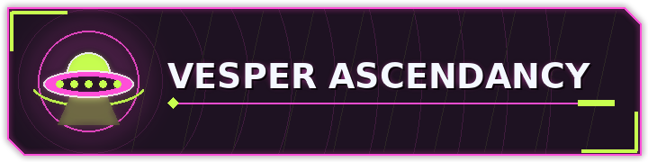
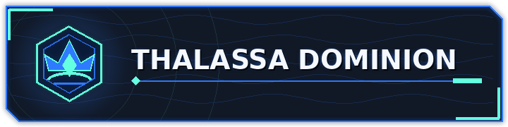
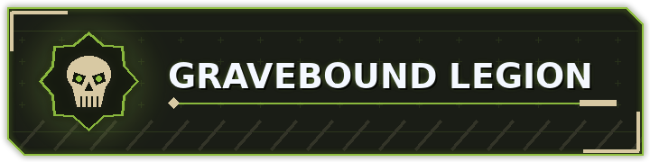
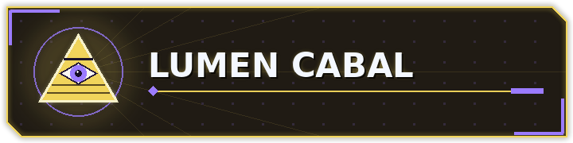

# BroWarz — AI-Only NPC Factions

v0.1.3 adds four **AI-only NPC factions** (IDs 4–7). They cannot be picked for a human seat: skirmish, the human seat of co-op, and map-editor test play remain limited to the four megacorporations in [`corporations.md`](corporations.md). They can appear as a **skirmish AI opponent**, the **co-op AI**, or **either side of an AI-vs-AI spectator match**, where they use the same AI controller and command validation as a corporation.

Each NPC faction has its own identity, colors, banner, theme track, combat modifiers and three unique units. Everything else — buildings, resources, tech tiers, fog and fortifications — is shared with the human corporations (see [`factories.md`](factories.md)).

## Faction Index

| ID | Key | Name | Identity | Color / accent | Logo | Theme music |
|---|---|---|---|---|---|---|
| 4 | `vesper` | Vesper Ascendancy | Alien UFO faction; high-speed airborne saucers and superior aerial combat | `#FF4FD8` / `#C7FF4F` | [vesper.png](../assets/banners/vesper.png) | [vesper.wav](../assets/music/vesper.wav) |
| 5 | `thalassa` | Thalassa Dominion | Atlantean naval faction; ocean and abyss dominance | `#2F7BFF` / `#64FFE0` | [thalassa.png](../assets/banners/thalassa.png) | [thalassa.wav](../assets/music/thalassa.wav) |
| 6 | `gravebound` | Gravebound Legion | Undead army; resilient infantry and attrition | `#8FBF3F` / `#D8C9A3` | [gravebound.png](../assets/banners/gravebound.png) | [gravebound.wav](../assets/music/gravebound.wav) |
| 7 | `lumen` | Lumen Cabal | Illuminati; foresight, stealth and reconnaissance | `#F2D65B` / `#9B7BFF` | [lumen.png](../assets/banners/lumen.png) | [lumen.wav](../assets/music/lumen.wav) |

## Vesper Ascendancy (ID 4, `vesper`)

- **Motto:** "Dominion begins above."
- **Background:** An off-world ascendancy that arrived in silent saucers and treats the planet's skies as its own airspace. Vesper's hit-and-run aerial formations punish any army that cannot contest the clouds.
- **Pros:** Air damage ×1.20; air speed ×1.30.
- **Cons:** Vehicle/ground HP ×0.80.
- **Theme:** `assets/music/vesper.wav`.

**Unique units** (native `_f4` thumbnails):

| Unit | Thumbnail | Role |
|---|---|---|
| `ufo_wisp` |  | Fast scouting saucer; opens engagements and baits anti-air fire. |
| `ufo_talon` |  | Agile strike saucer for air superiority and precision intercepts. |
| `ufo_nova` |  | Heavy saucer bomber that delivers the faction's main aerial punch. |

**Strategy:** Mass air, use the speed bonus to choose every engagement, and keep fragile ground assets out of sight. Vesper loses prolonged attrition on the surface, so hit factories and extractors before a ground army can form.

## Thalassa Dominion (ID 5, `thalassa`)

- **Motto:** "The sea remembers its masters."
- **Background:** An Atlantean dominion rising from the abyss to reclaim the shipping lanes and the continental shelf. Its fleets fight best where the map is mostly water.
- **Pros:** Naval HP ×1.25; naval damage ×1.15; sea unit cost ×0.90.
- **Cons:** Land/air damage ×0.85.
- **Theme:** `assets/music/thalassa.wav`.

**Unique units** (native `_f5` thumbnails):

| Unit | Thumbnail | Role |
|---|---|---|
| `abyssal_trireme` |  | Armored line warship that holds the surface. |
| `leviathan_carrier` |  | Capital carrier projecting air support across the ocean. |
| `nereid_raider` |  | Fast sea raider for flanks, shoreline strikes and pursuit. |

**Strategy:** Control coastlines, field cheap durable fleets, and let carriers extend reach over water. Avoid inland battles: cheaper ships do not compensate for weaker land and air firepower away from the sea.

## Gravebound Legion (ID 6, `gravebound`)

- **Motto:** "The fallen still march."
- **Background:** A legion of reanimated dead that never tires and never retreats. Gravebound wins by grinding opponents down through endless waves and cheap bodies.
- **Pros:** Infantry HP ×1.20; infantry cost ×0.85; sight ×0.85.
- **Cons:** Vehicle/air HP ×0.80.
- **Theme:** `assets/music/gravebound.wav`.

**Unique units** (native `_f6` thumbnails):

| Unit | Thumbnail | Role |
|---|---|---|
| `bone_legionary` |  | Resilient line infantry that anchors the attrition push. |
| `ghoul_stalker` |  | Fast stalker that tears into exposed flanks and stragglers. |
| `lichen_colossus` |  | Hulking bio-armor bruiser that absorbs fire for the line. |

**Strategy:** Press forward with cheap infantry, trade HP for territory and rebuild faster than the enemy can clear the field. Reduced sight means scouting and radar matter; thin vehicle or air columns are liabilities.

## Lumen Cabal (ID 7, `lumen`)

- **Motto:** "We saw you coming."
- **Background:** A hidden cabal that fights with foreknowledge, veiled agents and perfectly timed ambushes. Lumen prefers to win before the opponent understands the battle.
- **Pros:** Sight ×1.25; stealth duration ×1.30.
- **Cons:** All unit cost ×1.10; all HP ×0.90.
- **Theme:** `assets/music/lumen.wav`.

**Unique units** (native `_f7` thumbnails):

| Unit | Thumbnail | Role |
|---|---|---|
| `lumen_operative` |  | Cloaked infiltrator for reconnaissance and sabotage. |
| `lumen_oracle` |  | Long-sight controller that keeps distant targets visible. |
| `lumen_enforcer` |  | Protected shock unit that finishes what the veil exposes. |

**Strategy:** See first, strike from cloak, and disengage before costly units are traded away. The across-the-board cost and HP penalties punish mass production, so Lumen relies on information and layered ambushes rather than a stand-up war of attrition.

## Combat Modifiers

| Faction | Bonuses | Penalties |
|---|---|---|
| Vesper | Air damage ×1.20, air speed ×1.30 | Vehicle/ground HP ×0.80 |
| Thalassa | Naval HP ×1.25, naval damage ×1.15, sea unit cost ×0.90 | Land/air damage ×0.85 |
| Gravebound | Infantry HP ×1.20, infantry cost ×0.85, sight ×0.85 | Vehicle/air HP ×0.80 |
| Lumen | Sight ×1.25, stealth duration ×1.30 | All unit cost ×1.10, all HP ×0.90 |

These modifiers apply **only to units owned by that NPC faction** and stack with the armor/damage-type matrix, terrain and cloud cover, tech upgrades, cloak and detection, and the shared production rules described in [`design.md`](design.md) and [`units.md`](units.md). They do **not** change the four human corporations (IDs 0–3).

## Selection and UI

- AI faction selectors cycle through **IDs 0–7**: the four corporations followed by the four NPC factions. Skirmish enemies, the co-op AI and both spectator sides may use any of them.
- Human selectors stay at **IDs 0–3** for skirmish, the co-op human seat and map-editor test play; the NPC factions never appear in a human seat.
- Each NPC faction has its own banner (`assets/banners/<key>.png`) and its own theme WAV (`assets/music/<key>.wav`) supplied to the soundtrack system.
- Soundtracks are selectable in the main menu and in Settings. `AudioManager` resolves the logical `menu` and `battle` cues through the selected soundtrack, so NPC battle music follows that selection unless a dedicated NPC theme is chosen; the theme WAV listed above is the track available to that system for the faction.

## See Also

- [`units.md`](units.md) — illustrated rosters, including the AI-only units.
- [`design.md`](design.md) — combat, vision, AI, audio and mode rules.
- [`roadmap.md`](roadmap.md) — v0.1.3 release highlights and roadmap status.
- [`corporations.md`](corporations.md) — the four human-selectable corporations.
