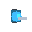
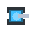

# BroWarz — Units

Representative thumbnails use the AeroDyne color scheme; each corporation recolors units with its own color.

## Infantry Robots

| Unit | Thumbnail | Role |
|---|---|---|
| Riflebot |  | Line infantry |
| Heavybot |  | Heavy infantry, crosses mountains |
| Sapperbot |  | Demolition and construction |
| Stealthbot |  | Cloaked recon/ambush |
| Sniperbot |  | Long-range precision |
| Rocketbot |  | Anti-armor infantry |
| Medicbot |  | Repairs friendly robots |
| Engineerbot |  | Builds and repairs structures |

## Mechanized & Armor

| Unit | Thumbnail | Role |
|---|---|---|
| APC/IFV |  | Transport and light cannon |
| Light Mech |  | Fast skirmisher |
| Light Tank |  | Fast armor |
| Main Battle Tank |  | Standard armor |
| Heavy Tank |  | Siege armor |
| Self-Propelled Artillery |  | Indirect fire |
| Anti-Air Vehicle |  | Air defense |
| Heavy Killer Mech |  | Anti-everything mech |
| Siege Mech |  | Long-range bombardment |

## Naval

| Unit | Thumbnail | Role |
|---|---|---|
| Patrol Sea Drone |  | Scout and patrol |
| Missile Corvette |  | Missile combatant |
| Attack Submarine |  | Torpedo/subsurface |
| Ballistic Missile Submarine |  | Strategic nuke platform |
| Landing Craft |  | Amphibious transport |
| Hovercraft |  | Land and sea, eel hazard |
| Cruiser |  | Capital ship |
| Battleship |  | Heavy naval firepower |
| Aircraft Carrier |  | Air support at sea |
| Frogman |  | Stealth, takes out capital ships |

## Air

| Unit | Thumbnail | Role |
|---|---|---|
| Scout Aerial Drone |  | Recon |
| Fighter Drone |  | Air superiority |
| Bomber Drone |  | Ground attack |
| AWACS Radar Drone |  | Vision and radar |
