# BroWarz — Units

Every unit has a large, detailed 48×48 pixel-art sprite (rendered below at 64×64) with a strictly uniform silhouette, structural shading, and weapon/chassis geometry across all four corporations (**AeroDyne Industries**, **FerroCore Heavy**, **Pelagic Systems**, and **Vanguard Robotics**), recolored solely by each corporation's primary color ramp.

## Allied Behavior

Unit behavior follows the active alliance graph from [`diplomacy.md`](diplomacy.md), queried through `GameManager.is_allied()`:

- **Shared sight:** allied teams reveal explored tiles and live contacts to each other; enemy buildings still stay hidden under fog until seen. Corvette sonar buoys likewise reveal submerged contacts to their owner and allies for 75 s.
- **No friendly fire:** auto-targeting, attack orders, orbital lasers and nuclear strikes skip allied units and structures. Capture and demolish orders reject allied buildings.
- **Repairs:** Sapperbots and other repair-capable workers mend allied units (`100 px`) and buildings (`110 px`) at `12 HP/s` (`18 HP/s` for the unified Sapperbot worker role).
- **AI:** skirmish/co-op/spectator AI treats allied teams as non-enemies when picking targets and evaluating threats.
- **Identity:** an allied team keeps its own corporation color, emblem and upgrades; co-op partners and spectator AI squads remain distinguishable even when they share a side.

## Infantry Robots

| Unit | AeroDyne | FerroCore | Pelagic | Vanguard | Role |
|---|---|---|---|---|---|
| Riflebot |  | 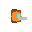 |  | 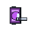 | Line infantry |
| Heavybot |  |  |  | 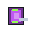 | Heavy infantry, crosses mountains |
| Sapperbot |  |  |  |  | Unified worker: demolition/breach, construction capture, and field repair (sapper/engineer/medic roles merged; `engineerbot`, `medicbot`, and `adv_engineerbot` are compatibility aliases) |
| Stealthbot |  |  |  |  | Cloaked recon/ambush |
| Sniperbot |  | 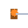 | 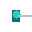 | 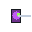 | Long-range precision |
| Rocketbot |  |  |  |  | Anti-armor infantry |

## Mechanized & Armor

| Unit | AeroDyne | FerroCore | Pelagic | Vanguard | Role |
|---|---|---|---|---|---|
| APC/IFV |  |  |  | 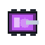 | Transport and light cannon |
| Light Mech |  | 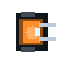 |  |  | Fast skirmisher |
| Light Tank |  |  |  |  | Fast armor |
| Main Battle Tank |  |  |  |  | Standard armor |
| Heavy Tank |  |  |  |  | Siege armor |
| Self-Propelled Artillery |  |  |  |  | Indirect fire |
| Anti-Air Vehicle |  | 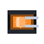 | 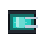 |  | Air defense |
| Heavy Killer Mech |  |  |  |  | Anti-everything mech |
| Siege Mech |  |  |  |  | Long-range bombardment |

## Naval

| Unit | AeroDyne | FerroCore | Pelagic | Vanguard | Role |
|---|---|---|---|---|---|
| Patrol Sea Drone |  |  |  |  | Scout and patrol |
| Missile Corvette |  |  |  |  | Missile combatant; deploys sonar buoys (`K`, 30 s cooldown) that reveal submarines to owner/allies for 75 s |
| Attack Submarine |  |  |  |  | Torpedo/subsurface |
| Ballistic Missile Submarine |  |  |  |  | Strategic nuke platform |
| Landing Craft |  |  |  |  | Amphibious transport |
| Hovercraft |  |  |  |  | Land and sea, eel hazard |
| Cruiser |  |  |  |  | Capital ship |
| Battleship | 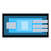 |  |  |  | Heavy naval firepower |
| Aircraft Carrier |  |  |  |  | Air support at sea |
| Frogbot |  |  |  |  | Amphibious stealth bot, takes out capital ships |

## Air

| Unit | AeroDyne | FerroCore | Pelagic | Vanguard | Role |
|---|---|---|---|---|---|
| Scout Aerial Drone |  |  |  |  | Recon; part of every player's starting escort and the AI's forward sweeps |
| Fighter Drone |  |  |  |  | Air superiority |
| Bomber Drone |  |  |  |  | Ground attack |
| AWACS Radar Drone |  |  |  |  | Vision and radar |

## AI-only NPC units

The four AI-only factions in [`npc.md`](npc.md) cannot be selected by human players, so their unique units cannot be trained by human players either. Each has a **unique per-unit sprite and a single faction-native thumbnail** (`_f4` Vesper, `_f5` Thalassa, `_f6` Gravebound, `_f7` Lumen) instead of the four corporation recolors above. These units appear only when an AI side uses that faction in skirmish, co-op or spectator play.

| Unit | Faction (ID) | Native thumbnail | Role |
|---|---|---|---|
| `ufo_wisp` | Vesper Ascendancy (4) |  | Fast scouting saucer; opens fights and baits anti-air. |
| `ufo_talon` | Vesper Ascendancy (4) |  | Agile strike saucer for air superiority and intercepts. |
| `ufo_nova` | Vesper Ascendancy (4) |  | Heavy saucer bomber and main aerial damage dealer. |
| `abyssal_trireme` | Thalassa Dominion (5) |  | Armored naval line warship. |
| `leviathan_carrier` | Thalassa Dominion (5) |  | Capital carrier projecting air support at sea. |
| `nereid_raider` | Thalassa Dominion (5) |  | Fast sea raider for flanks and shoreline strikes. |
| `bone_legionary` | Gravebound Legion (6) | 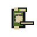 | Resilient line infantry for attrition pushes. |
| `ghoul_stalker` | Gravebound Legion (6) |  | Fast stalker that exploits exposed flanks. |
| `lichen_colossus` | Gravebound Legion (6) | 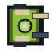 | Soaks fire as a hulking bio-armor bruiser. |
| `lumen_operative` | Lumen Cabal (7) | 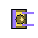 | Cloaked infiltrator for recon and sabotage. |
| `lumen_oracle` | Lumen Cabal (7) |  | Long-sight controller that holds distant targets visible. |
| `lumen_enforcer` | Lumen Cabal (7) |  | Protected shock unit that finishes exposed targets. |

NPC factions otherwise draw from the same shared roster and production buildings as the corporations; their faction modifiers are listed in [`npc.md`](npc.md).
